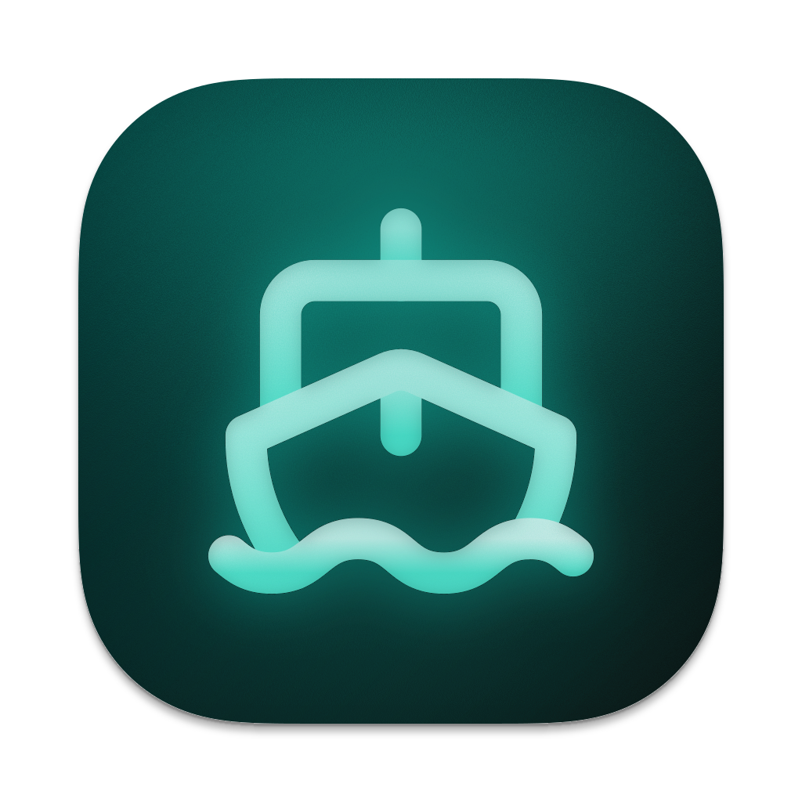

<div align="center">
  

  <h1>Navigator</h1>

  A fairly polished Stremio client with an assistant built in

  <p>
    
    
    
    
    
    
  </p>

  <p>
    
    
    
    
    <a href="LICENSE"></a>
    <a href="desktop/THIRD-PARTY.md"></a>
  </p>

  <p><a href="desktop/README.md">Desktop</a> · <a href="android/README.md">Android</a> · <a href="ios/README.md">iOS</a></p>
</div>

## Demo

https://github.com/user-attachments/assets/697d0384-1f3b-45df-8cd4-6d2bb6405e46

## What it does

- **Browse and watch.** Your Stremio library, addons, and watch progress in one place.
- **Ask Navigator.** Find a title, look up an episode from a description, or ask about what you're watching. Bring your own AI provider, including Ollama for local setups.
- **Web research with TinyFish.** Optionally search the web and read sources to help identify an episode from the details you remember or answer questions about a title.
- **Find the scene.** Jump to a moment or get an explanation using available subtitles.
- **Make it yours.** Light and dark themes, artwork colors, and subtitle appearance and timing controls.
- **Native playback.** The desktop app uses mpv, Android uses ExoPlayer, and iOS uses VLC.

Android and iOS are still a little rougher than desktop. I'm considering Expo for the mobile apps.

Sign in with your Stremio account and configure your addons. AI features need a provider configured in Settings; scene features depend on subtitle availability.

## Run locally

You'll need Node.js 22+.

```sh
git clone https://github.com/AyaanZaveri/navigator.git
cd navigator
npm ci
cp .env.example .env.local
npm run dev
```

Open [localhost:3000](http://localhost:3000). You can set up AI and a TMDB artwork token in Settings; shared server keys are optional for local use.

Visitors can browse the home screen, search, and TMDB title details before signing in. Set `TMDB_API_READ_ACCESS_TOKEN` on hosted deployments to populate guest discovery. Guests prefer that shared key over any previous account's saved token. The home screen includes weekly trends, top-rated movies and shows, and regional Netflix catalogs sorted by TMDB popularity. `TMDB_WATCH_REGION` selects the provider region (default `US`); these rows are not Netflix's own Top 10 chart. The top-right sign-in dialog supports Stremio's official device linking or email/password and connects add-ons, library, and Continue Watching.

For web research, connect TinyFish in Settings and enable web search. You can also provide a shared key through `TINYFISH_API_KEY` in your environment file.

For production, set `NAVIGATOR_SESSION_SECRET` with `openssl rand -hex 32`, then run `npm run build` and `npm start`. See the [environment example](.env.example), [security setup](docs/security-hardening.md), and [Cloudflare guide](docs/cloudflare.md).

## A few more things

- [Desktop setup and packaging](desktop/README.md)
- [How Navigator finds episodes and scenes](docs/navigator-tool-reliability.md)
- [Vercel Analytics and Speed Insights](docs/vercel-analytics.md)
- [Skip timing providers and credits](docs/skip-provider-audit.md)

Bugs, ideas, and pull requests are welcome.

## License

The web app is [GPL-3.0](LICENSE); the desktop shell is [AGPL-3.0](desktop/THIRD-PARTY.md). See [third-party credits](THIRD-PARTY.md) for the libraries, assets, and other work used here.
